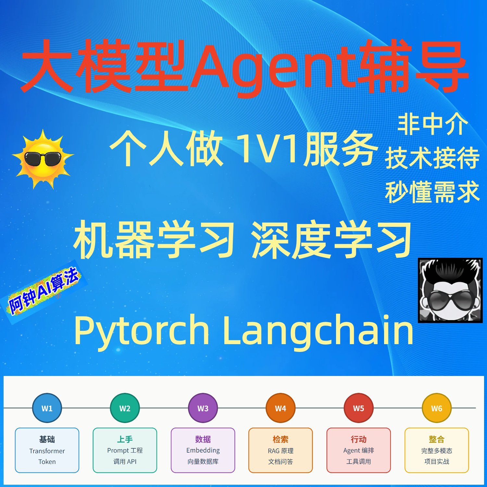

# AI_code_pulich

> AI 学习与科研实战代码库。
> 全部内容以可直接运行的 `.ipynb` / 单页 `.html` 形式提供，无需配置本地环境。


---


# 时间线

```
2025-09-20  16:08  初始提交 c132919  ── README / LICENSE / .gitignore
2025-09-20  16:43  提交 0f010bc     ── 数据集来源对比 HTML
2025-09-24  11:45  提交 40ca86c     ── Colab 教程 Notebook
2025-09-27  11:22  提交 978dda4     ── 医学图像分类 第 2 章
2026-11-09  20:28  提交 189cab8     ── YOLO26 切片预测（Colab 直建）
```


# 作者与联系

| 渠道 | 账号 / 主页 |
| :--- | :--- |
| 小红书 | [阿钟AI论文辅导](https://www.xiaohongshu.com/user/profile/62c1b55c000000001b029751) |
| B 站 | [阿钟AI算法](https://space.bilibili.com/353234591) |
| 抖音 | [抖音主页](https://www.douyin.com/user/self?from_tab_name=main) |
| 淘宝 | [大模型 Agent 1v1 辅导](https://item.taobao.com/item.htm?id=1087228081366) |
| 微信 | `azhongai666` |
| QQ | 2084339727 |
| GitHub | [@azhongai666](https://github.com/azhongai666) |

## 微信

微信号：**azhongai666**

<p align="center">
  
  <br>
  <sub>扫码添加微信好友</sub>
</p>

## 大模型 Agent 1v1 辅导

<p align="center">
  <a href="https://item.taobao.com/item.htm?id=1087228081366">
    
  </a>
  <br>
  <sub>👆 点击图片进入淘宝商品页</sub>
</p>

- **形式**：个人 1V1 服务，非中介、技术本人接待，秒懂需求
- **方向**：机器学习 / 深度学习 / PyTorch / LangChain
- **6 周路线**：W1 基础（Transformer、Token）→ W2 上手（Prompt 工程、调用 API）→ W3 数据（Embedding、向量数据库）→ W4 检索（RAG 原理、文档问答）→ W5 行动（Agent 编排、工具调用）→ W6 整合（多模态、项目实战）

---

# License

本项目基于 [MIT License](LICENSE) 开源，Copyright (c) 2025 azhongai666。

---

<sub>📌 仓库内容为教学演示代码，医学影像部分不构成任何诊断建议。</sub>
